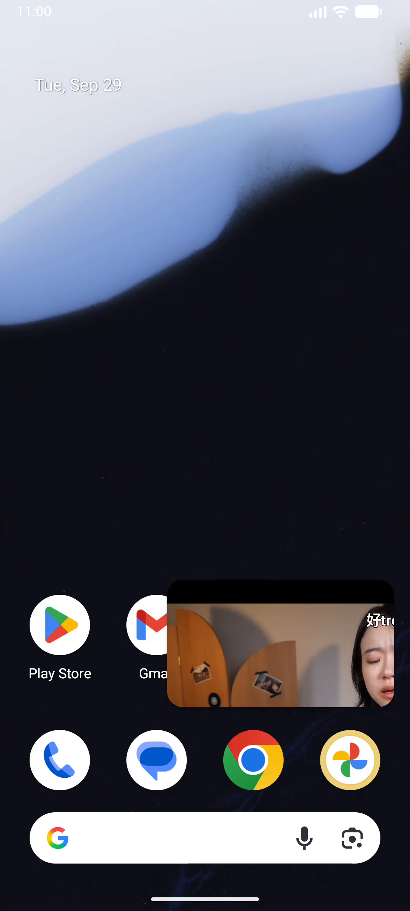
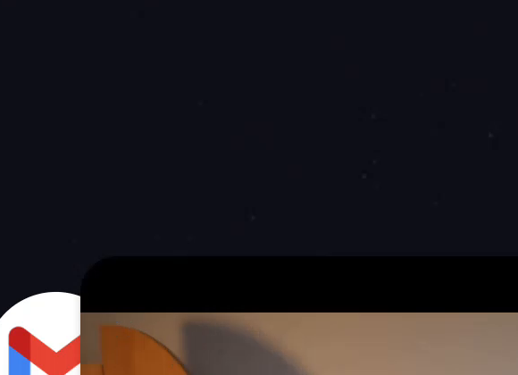
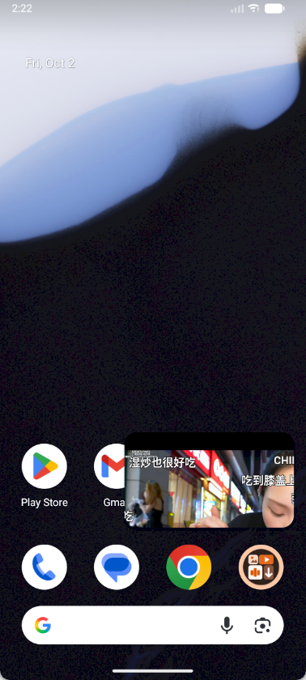

# PiliPlus Android PiP 落定后跳动记录

## 当前状态：2026-10-06（固定根画布方案已验收）

### 当前阶段已验收：原生固定根画布方案

用户先确认“目前已经不再闪烁了”，随后明确确认 **直接上滑进入 PiP、最近任务进入 PiP、PiP 返回播放页三种均已正常**。以下旧的失败/未验收状态均为历史，不代表这一版的结果。

- 已安装 `native-fixed-root-null-safe-and-exit-guard`。Activity 照常缩小，Flutter 根画布保留正常尺寸，原生容器持续对进入前的视频区域缩放、裁切；退出后恢复原生变换，在正常窗口与系统栏恢复后解除锁定。播放器和纹理不因 PiP 重建。
- 已解决实验容器的 null clip 日志崩溃；诊断收集与发送受异常边界保护。旋转返回的测量请求移到布局完成后的消息队列，测试使用实际附着的 Android View，避免 detached View 的 post 不执行造成测试失真。
- 返回仍锁定时，Dart playback/sourceRect 保护延续到原生释放；原生也拒绝此期间写入临时尺寸的源矩形。
- 验证：5 项原生单测、4 项 Flutter viewport 测试通过，相关 Dart analyze 无问题，APK 构建及覆盖安装成功；当前用户已提供三种路径的视觉通过结果。没有截图/录屏，以连续系统元数据和用户人工结果验收。
- 可恢复基线保存在 `../pip-20261006/native-fixed-root-baseline/`：APK、带哈希的 build.json、源码快照 ZIP（包含新增原生文件及 JUnit XML）、tracked-source.patch。新包运行文本证据在 `../pip-20261006/native-fixed-root-user-verified/`，JSONL 12,207 条、损坏与序号缺口均为 0。
- 当前阶段完成。功耗增幅尚未测量；用户已明确接受先采用固定大画布，再考虑小尺寸缓冲区同步交接优化。后续优化必须保留本基线并重新覆盖三种路径，不能覆盖已确认正常的包后失去回退依据。

- 按用户“每一帧的大小”要求，已增加连续 Perfetto 系统合成监听，当前恢复版 APK 不变。`MODE_ACTIVE + TRACE_FLAG_BUFFERS/COMPOSITION/HWC` 同时采集 SurfaceFlinger、FrameTimeline、WindowManager 按帧状态和 WM Shell 转场。4 秒采集实际得到 118 个图层时点、117 条实际帧时序；导出含应用及祖先的 1,770 条图层记录、236 个缓冲样本、119 个不同图层/帧号组合，损失统计为空。反复显示的相同缓冲会在多个时点出现，不能把全部缓冲样本称作新视频帧。证据目录为 `../pip-20261006/pip-frame-listener-check-extracted/`。
- 新工具 `tool/pip_layer_trace.py` 输出 `buffer-frames.jsonl`（tsNs、layer id、curr_frame、active_buffer 宽高、父链引用、原始裁切/变换/显示区域）、`layers.jsonl`（应用及每个父图层的所有原始字段）、实际帧时序、转场信息和损失统计。缺失字段不擅自补成单位矩阵，不从元数据推断视觉成功。系统实际呈现和逐缓冲变化信息已可取得，下一步需要覆盖用户看见的“正常→异常→正常”。
- 连续手工测试监听已启动，后台输出 PID 10689，文件已实际写到 45,487,250 字节。kill -0 返回 Permission denied，不能宣称该方式验证成功；以进程列表及 Perfetto session query 核验运行。元数据索引 `../pip-20261006/frame-listener-live.json`。限制 180 秒或 128 MiB，防止再次耗尽模拟器空间；全过程无截图、无录屏、无程序手势、无重装。此采集模式有额外开销，不能把采集时延直接归为原始 bug 的开销。

- 用户进一步指出：转场全程已有正常且尺寸随动画变化的小窗，落定后才出现一次异常再恢复。因此撤销“转场只缩放、落定时窗口才变小”的绝对顺序说法，也不能仅以 Flutter 布局更新延迟解释整段“正常→异常→正常”。Android 窗口变化、应用缓冲提交和合成变换需要逐次对齐，必须定位正常画面之后的错误提交，才能建立直接因果。
- 新增系统合成元数据调查：Perfetto 数据源已确认可用；`MODE_GENERATED` 输出 943 字节，经判断未得到历史图层，不能当成回溯证据。`MODE_DUMP` 取到 1 个快照、101 个图层（43,082 字节），保存在 `../pip-20261006/pip-layers-dump.pftrace`。已使用官方 trace_processor_shell v58.2 解析（SHA256 `adfa6bad3d72be3ba9b83fa2b17b69fa13b3ab1cad0f42e52b86188bd5f0f997`）。当前落定 Flutter BLAST 图层 #774 的 active_buffer、source_bounds、destination_frame 都为 598×336，screen_bounds 为 (440,1527)-(1038,1863)，curr_frame=27289。这仅是当前正常稳态，无法证明异常瞬间。原始字段见 `../pip-20261006/current-layer-geometry.csv`。未截图或录屏。
- 原生单测首次完成：5 项中 4 项通过，1 项发现旋转返回后的子 view 测量尺寸仍为 400×900，未恢复为 900×400。原因是 onLayout 内 requestLayout 的标志可在 View.layout 收尾时清除。已改为 post 后重新请求子 view 和容器测量，测试也推进真实主线程消息队列后检查结果，正在复跑。实验根容器继续禁用，不能把测试问题修正当成当前 PiP 视觉问题已经解决。

- 用户随后补充这轮恢复版“没有改善”。因此上述恢复版操作的人工视觉结果明确为失败，不再写“等待补充”；无新 crash 仅说明实验容器的崩溃已撤回，绝不等于原 PiP 问题解决。当前具体根因尚未查实，窗口尺寸与 Flutter 帧提交不同步是已记录的现象及主排查方向；它与可见放大之间的直接因果、错误帧实际来自哪层仍未证明。

- 恢复版 `root-host-disabled-serial-trace` 的新一轮人工操作已取回，存于 `../pip-20261006/restored-manual-snapshot/` 和 `restored-manual-android/`：应用 PID 8980；Flutter 文件 6,503 条完整记录，损坏 0、序号缺口 0；5 次进入、4 次返回，当前进程 crash buffer 无新异常。Texture 挂载 1 次、卸载 0 次。首轮进入有三次 RenderFlex 溢出（30、23、25 像素）；最大 build 401,787 微秒。Activity 根 Surface 仍在 1080×2400 与 598×336 间切换，Flutter 几何随后才更新；所有已记录的落定 PiP 内容矩阵均为正常 0.311111 等比适配，没有日志证据证明后续错误矩阵。人工画面结果尚未补充，不能因无闪退就判 PiP 跳动通过。
- 当前源码新增原生 JVM 回归检查（Robolectric SDK 28、LEGACY graphics）：覆盖这次“进入但尚未缩窗”的 null clip 崩溃路径、保留子 view 大窗口测量尺寸、返回和旋转恢复，以及诊断回调抛异常不影响布局；这些不是实际 Flutter Surface 合成或模拟器画面测试。原生日志的数据收集与发送改为受异常边界保护；PiP 队列也在单条异常后释放后续指令。尚未把这些后续源码改动部署到模拟器，安装版仍为恢复版。测试框架配置移除了布局测试不需要的原生图形库依赖，测试结果须以生成的 JUnit XML 为准。

- **最新反馈：进入 PiP 整个 app 闪退。** crash buffer 连续记录 PID 7937、8499、8715 相同异常：`NullPointerException`，`PipRenderHost.onLayout(PipRenderHost.kt:107)`。`FlutterView.clipBounds` 是 Android Java platform type，可为 null，直接调用其 `toString()` 在进入后仍为正常大窗口的那次布局崩溃。已修成安全调用，同时撤销 MainActivity 中 `installRenderHost()` 的调用，实验根容器不再安装或执行。该候选未通过，不能作为根 Surface 固定成功的证据。原始堆栈保存于 `../pip-20261006/native-root-host-crash.log`。恢复版保留串行文件日志器；原 PiP 闪烁尚未解决。

- 新候选版：`fixed-root-native-crop-serial-file-writer`，构建成功并覆盖安装。新增 Android `PipRenderHost`，进入时锁定已有 FlutterView 的正常测量尺寸和视频源矩形，Activity 缩小时仅通过原生 view 的 scale/translation/clip 适配小窗；保持同一 Flutter 根 Surface 的缓冲尺寸。返回时还原原生变换，等待正常窗口及系统栏可见性恢复再释放锁。Dart 镜像 `renderHostLocked`，锁定期间保留原 MediaQuery 和页面布局，不再按 PiP 窗口重排播放器。仍为 Flutter Texture 视频合成，不是纯原生播放器。
- 4 项 viewport 测试通过，包括原生锁定期间进入、活动、退出各阶段不重挂载子节点、不改变原边距，及既有回退路径。这只验证 Dart 布局约束，未证明 native Surface 合成或实际画面没有闪烁。
- 运行时发现异步日志器的回归：在 IOSink.flush 未完成时调用 write 抛出 `Bad state: StreamSink is bound to a stream`，使 `command.begin` 的诊断异常阻断 PiP 方法调用，并让部分播放器挂载不完整。已改成生产端只追加 StringBuffer，单个串行 flusher 才访问 sink；event 捕获诊断自身异常，不能再向播放逻辑抛出。修正包 PID 7937 已实际记录 `command.end`，完整 JSONL 可读取，未再观察到该 PID 的 bound-stream 报错。旧 PID 7490 的运行不能用作 PiP 候选修复结果，因为没有真正进入 PiP。
- 本轮未捕获图像。曾做一次正常播放和 Home 的日志检查，但首次检查时播放已暂停，未触发 PiP，因此未证明新原生尺寸锁定的不变量。后来播放恢复后 Home 的检查受上述旧日志器故障阻断，也不算通过。最终串行 writer 包已安装，实际 PiP 进入/返回的根 Surface 尺寸和人工视觉结果仍待核验，不提前宣告修复。该方案保持 PiP 内全尺寸 Flutter 画布，渲染成本可能高于缩小画布的实现。

- 本轮人工三种操作已分析并冻结证据，见 [逐段时序和证据边界](../pip-20261006/manual-three-cases-analysis.md)。当前安装版已更新为 `async-file-full-trace`：保留全部 Dart 记录，异步写私有 JSONL，避免同步分段刷屏增加主线程延迟；mpv 和原生窗口采集保留。该修改通过静态检查、构建并成功覆盖安装，仍是诊断修正，不是已验收的 PiP 修复。

- 最新人工反馈（10-06）：路径一、退出恢复的问题仍在，路径二再次回归。用户进一步明确现象是“左上角放大”。三项均未通过；此前“只剩黑闪”的描述已过时。
- 用户后来明确要求停止截图和录屏，以人工观察为准；下文旧录屏只保留作历史证据。后续只收集状态、布局和 Surface 日志，不生成新截图。
- 当前未提交架构为 `libmpv → SurfaceProducer → Flutter Texture`，已移除视频 PlatformView 注册和使用。它仍经 Flutter 合成，不是完整的原生视频界面。不能据此断言 Flutter 引擎已被证实有缺陷。
- 10-03 诊断日志显示 `active` 回调在 Activity 仍为 `1080×2400` 时到达，随后才变成 `598×336`。一个中间版本在此期间把 Flutter 视频布局从 `411×231` 改成 `411×914`，再改成 `228×128`。这是已确认的额外布局过程，是否直接导致黑帧仍是待验证假设。
- 已撤回上一轮新增的 `entering` 时提前切换及边距清零，保留按长、短边判断返回尺寸的逻辑。回归前代码另存 `../pip-20261006/regressed-pip-viewport.dart` 和 `regressed-pip-viewport-test.dart`，便于后续比较。
- `test/pip_viewport_test.dart` 的 3 项测试通过。它们只证明简化组件的状态和布局行为，未覆盖真实详情页/播放器树，是此前验证的缺口，不能当作无闪烁的证据。
- 新增详细诊断：原生 `PiliPlusPiPTrace` 逐 vsync 读取窗口、配置、insets、Flutter 根 view、SurfaceView 尺寸及 Surface 生命周期；Dart `PIP_TRACE` 记录实际 Flutter 帧、raster 时序、视频节点矩形、完整变换矩阵、Texture/controller/state 身份、挂载卸载、指令排队和回调。每次进入/退出相关回调后密集跟踪 8 秒，不主动请求绘制或捕获图像。完整 Flutter 异常保留原错误处理器并按编号分段，避免大诊断文本被 logcat 截断。
- 应用户要求扩大日志密度：记录解码/渲染底层日志以及 playing、buffering、position、size、videoParams 和 error 原始事件；随播放器既有订阅一起释放。最初把全部 mpv trace 推到 Dart 队列产生了 20,608 次 overflow，不能用这份受采集干扰的日志判断转场原因。现已将 Dart 桥恢复为 warn，将完整 `all=trace` 写入 mpv 原生文件 `files/pip-diagnostics/mpv-<UTC微秒>.log`，保留底层细节同时避免消息队列被 trace 填满。此为诊断包，不是已验收修复包。当前日志及 APK 哈希索引：`../pip-20261006/current-build.json`。
- 已实测 Android Dart 控制台约 1 KB 截断，旧的大几何记录失效。现按 700 字节阈值、120 字符分段，附序号、分段号和总段数；`tool/pip_trace.py` 重组原始记录并明确报告损坏与缺段。最新一次采集校验得到 3,838 条完整记录、226 条几何记录，损坏 0、缺段 0；结果保存在 `../pip-20261006/segmented-trace-extracted/summary.json`。这只证明采集完整，不证明画面正常。
- 当前安装版为 `native-mpv-file-and-segmented-flutter-trace`。文本监听文件为 `../pip-20261006/20261006-203607-segmented-trace.log`；已取回的 mpv 原生文件为 `../pip-20261006/mpv-native/mpv-1791290225556640.log`，约 1.25 MB。传输验证使用了 1080×1920 竖视频，未执行新的 PiP 手势；不能冒充用户原先横视频的两条入口和退出验收。诊断日志可能影响时序，也不能承诺零开销。
- 后续复查原生 mpv 文件：`10.910 s Resize: 1080x1920` 之前是 `pause=true`、`stop`、`playlist-clear`，之后是解码器卸载；尺寸未变。这一条不能当成 PiP 内部错误缩放。新完整日志当前只含启动和播放的传输验证，没有进入 PiP 的记录。
- 为区分尺寸通知与布局提交，再增加 `player.metrics`：直接读取 FlutterView 的物理尺寸、DPR、各项 insets，并同时保留尚未更新的 MediaQuery 尺寸。几何样本亦包含真实 engine view 数据。新增 `layout.ancestorChain` 在祖先链变化时记录最多 40 层 RenderObject 身份、约束、尺寸、parentData、paintBounds 和到根的矩阵，覆盖视频到滚动页、根布局；相同链不重复发送。这些信息用于辨别是谁修改了视频的坐标或约束，不预先认定引擎、播放器或页面哪一层有错。
- 上述补充已通过 `flutter analyze --no-pub lib/plugin/pl_player/view/view.dart`，x86_64 Debug APK 构建成功并覆盖安装，应用进程 6516 启动、原文本监听进程 25956 继续收到该进程的新记录。最新安装版名为 `engine-metrics-and-render-ancestor-trace`，以 `current-build.json` 为准。未再执行 PiP 复测、截图或录屏；原问题仍未验收。
- 完整诊断包安装记录：通用 APK 更新曾报 `INSTALL_FAILED_INSUFFICIENT_STORAGE`。已构建并成功安装 `build/app/outputs/flutter-apk/app-x86_64-debug.apk`（85,348,256 字节）；模拟器同一 AVD 已恢复前台，原数据保留。日志 `../pip-20261006/20261006-202612-full-trace.log` 已实际写入约 2.28 MB，原生 trace 序号达到 1675，监听 PID 5308 在核验时存活。安装和日志写入已验证，PiP 修复仍未验证。
- 本次人工日志保存到 `../pip-20261006/regressed-three-cases.log`。它显示一次 Texture/Surface 创建，此后多次 PiP 进入/退出没有视频 Surface 重建，同时出现 RenderFlex 溢出。溢出和裁切的因果关系未被证明。
- 实际运行时渲染树已通过 Dart VM 文本接口保存到 `../pip-20261006/render-tree-pip.txt`：已落定的根和播放器约为 `227.8×128`；Texture 的局部原始尺寸 `731.4×411.4` 位于 `FittedBox(contain)` 内。这种原始尺寸本身不等于异常，必须和完整变换、原生实际提交帧对齐；一个已落定的树不能证明转场中间帧。
- 最终验收仍须分别确认路径一、路径二、退出恢复、首次播放和切换视频；编译、安装、状态日志都不代替视觉结果。

- 记录日期：2026-10-02
- 分支：`pip`
- 应用：`com.personal.piliplus`
- 设备：`emulator-5554`，Android API 36，Medium_Phone AVD
- 播放器：`media_kit` Flutter Texture
- 现象阶段：进入 PiP 后窗口已经落定，约 1–2 秒后出现一次画面跳动。

## 已确认的视觉现象

PiP 小窗的外框已经固定，视频内容却短暂以左上角为原点放大并裁切：

- 顶部出现一条黑色区域；
- 右侧人物只剩半边，画面被截掉；
- 随后画面恢复为完整的 16:9 视频。



上图是原始全屏截图，异常 PiP 位于右下角。下面是同一帧的 PiP 局部裁剪，专门用于后续对比：



证据文件：

- 原始录屏：`..\\.codex-pip-entry-current2.mp4`
- 原始帧：`pip-settled-jump-glitch-full.png`（来自录屏抽帧 `old-06.png`）
- 局部帧：`pip-settled-jump-glitch-crop.png`
- 联系表：`old-detail.png` 只能用于辅助定位，不能把左上角的全屏帧当作 PiP 证据。

## 时序证据

该录屏在发送 Home 手势前已开始录制。原生日志记录：

```text
11:00:21.832 phase=entering generation=28 reason=ui-transition
11:00:22.855 phase=active generation=29 reason=mode-changed
```

录屏中前几帧是正常的 PiP 画面；约在 `1.1 s` 的抽帧出现异常放大/裁切。因此问题不只是“进入动画还没完成”，而是 PiP 已经进入 `active` 后仍发生了第二次显示变换。

用户对证据的修正：联系表左上角第一张是误截到的非目标帧，不能作为结论依据。

## 用户补充的两条复现路径

这不是一个可以合并描述的现象，必须分别验证：

### 路径一：直接上滑回桌面

正在播放的页面直接随手势缩成 PiP。画面在转场中以极快速度变形并闪一下，随后通常落定。此前用 `KEYCODE_HOME` 做的录屏对应这条路径；它可以捕获“落定瞬间”的短暂异常，但不能证明第二条路径已经解决。

### 路径二：先进入最近任务，再点空白进入桌面

上滑进入最近任务页面后，点击任意空白区域进入桌面，PiP 会直接显现，几乎没有转场变形；但视频会持续以左上角为原点放大裁切，而不是只闪一下。用户提供的原始证据如下：



该原图已保存为 `user-case2-persistent-top-left-crop.png`。后续录屏和日志必须标记 `direct-home` 或 `recents-then-desktop`，不能把两种入口混为一次通过。

## 当前实现中需要重点检查的地方

1. `PipCoordinator` 在 Android 12+ 先收到 `onPictureInPictureUiStateChanged(entering)`，随后收到 `onPictureInPictureModeChanged(active)`。
2. `AndroidPipViewport` 保留同一个页面和 Texture，但原实现只在 `active` 阶段套用 Transform/Crop。
3. Android 可能先把 Activity 的约束缩到 PiP，再异步把 phase 回调送到 Dart；这会造成首个小窗口帧仍按整页/左上角布局绘制。
4. 如果首个小窗口帧已正确，随后 `active` 再套一次 Transform/Crop，就可能出现“外框不动、内容再次放大裁切”的第二次跳变。
5. 退出阶段曾观察到临时的 `sourceRect=Rect(1, 0 - 597, 336)`；此类 PiP 尺寸矩形不能写回下一次全屏的 `sourceRectHint`。

### 2026-10-02 新发现：状态回调出现反向顺序

`20261002-223208-574-Home-after.log` 记录到一段不应出现的状态回退：

```text
14:21:52.955 phase=active generation=7 reason=mode-changed
14:21:53.148 phase=entering generation=8 reason=ui-transition
```

也就是已经收到 `onPictureInPictureModeChanged(true)` 进入 `active` 后，延迟到达的 `onPictureInPictureUiStateChanged(transitioningToPip=true)` 又把状态改回 `entering`。这会让 Dart 的 `PipViewport` 再次收到状态变化并重新计算保护/裁剪几何，和“窗口外框不动、内容再次跳动或持续裁切”相符。状态机应保持单调 `idle → entering → active`；`ui-transition` 到达时若当前已经是 `active`，必须忽略，不能回退。

同一时间段的旧记录 `pip-research-20260910/*-Home-after.log` 没有这种 `active → entering` 顺序，说明它不是 Android 固有的正常顺序，而是当前 S+ `onUserLeaveHint` 提前设为 `entering` 后引入的竞态候选。

## 当前修复方向（暂未证明解决）

- 在 Dart 收到 phase 回调之前，依据窗口从全屏骤缩到 PiP 尺寸的事实识别一次 PiP resize，保留进入前的 MediaQuery/source layout。
- 只有在窗口同时显著小于原始宽高时才套视频裁剪，避免把状态栏/insets 的小变化误判成 PiP。
- `active` 回调到达后不得再次改变已经正确显示的视频几何位置。
- 继续保持同一个播放器、同一个 Texture 和同一棵页面树，不创建第二个解码器或第二个 PiP 页面。

## 验收标准

- 进入后持续录制至少 4 秒；
- 小窗外框固定后 1–2 秒内，视频始终完整、比例稳定、没有左上角放大裁切或黑色顶部跳变；
- 日志中 `active` 前后不再出现第二次视频几何切换；
- 退出再进入时不发送 PiP 尺寸的临时 `sourceRect`；
- Flutter PiP widget tests、Flutter analyze、Debug APK 构建通过，并重新安装到 `emulator-5554` 后复测。

## 2026-10-02 中间版本验证（不能作为解决证明）

- `test/pip_viewport_test.dart`：2 个测试通过；覆盖了 Android 先缩小窗口、后到达 `active` 回调的时序。
- Flutter analyze：通过。
- Debug APK：构建成功并安装到 `emulator-5554`。
- 真实录屏：`20261002-214857-997-Home.mp4`，持续约 4.3 秒；日志只有一次 `entering` 和一次 `active`：

```text
13:48:41.076 phase=entering generation=1 reason=ui-transition
13:48:42.161 phase=active generation=2 reason=mode-changed
```

本次录屏的落定帧 `current-frames/frame-04.png` 至 `frame-09.png` 未看到旧证据中的“左上角放大、右侧被截掉、顶部黑条随后跳变”。这只能说明该次真实录屏未复现，不能证明两条入口路径都已解决；用户随后确认第二条路径仍会持续左上角放大裁切。录屏由后台无窗口模拟器产生：模拟器进程使用 `-no-window`，截图和录屏均来自 `emulator-5554` 的 ADB 输出，不是桌面上另一个可见模拟器窗口。

## 其他开发者的处理方式

检索了开源播放器、Flutter PiP 插件和实际问题报告后，能重复看到的处理模式不是继续给整页 Flutter 页面叠加缩放/裁切，而是把 PiP 内容边界收窄到一个连续的原生视频 surface：

1. **PiP 只承载视频 surface，控制层移出 PiP。** `flutter-native-video-player` 使用原生 ExoPlayer/AVPlayer，并在 PiP 或全屏时回退到原生 platform view；它明确把 PiP 限定为视频 surface，隐藏 Flutter 叠加层。这个结构避免了 PiP 窗口缩小时整棵 Flutter 页面按左上角重新排版。参考：[flutter-native-video-player](https://github.com/plug-and-pay/flutter-native-video-player)。
2. **保留同一个 Surface/解码器，不在生命周期回调里重建。** Android PiP 的回调顺序由 SystemUI 和 WindowManager 异步协调；SurfaceView 的连续性比在 `onStop`、`surfaceChanged` 或 `active` 回调中重建播放器更重要。参考：[Android PiP 生命周期与 SurfaceView 分析](https://xckevin.github.io/en/blog/android-picture-in-picture-pip/)、[ExoPlayer SurfaceView 闪烁问题](https://github.com/google/ExoPlayer/issues/8611)。
3. **等真实窗口尺寸变化，再更新 surface 布局。** VLC 在视频 surface 容器上监听 layout change，并在布局完成后重新安排视频 surface；腾讯 RTC 的 PiP 示例也在 `onPictureInPictureModeChanged` 中重新设置视频 view 的宽高。参考：[VLC VideoHelper.java](https://github.com/videolan/vlc-android/blob/master/libvlc/src/org/videolan/libvlc/VideoHelper.java)、[腾讯 RTC PiP 文档](https://trtc.io/document/74577)。
4. **把 `sourceRectHint` 当作系统动画提示，而不是最终画面变换。** 开源 Flutter 示例通常同时设置 source rect、视频宽高比和 `seamlessResizeEnabled`，但仍用原生回调/外部状态监视器判断是否真的进入 PiP；调用成功不等于窗口已经落定。参考：[Agora Flutter PiP 示例](https://github.com/AgoraIO-Extensions/Agora-Flutter-SDK/blob/main/example/lib/examples/advanced/picture_in_picture/picture_in_picture.dart)、[opentraa/pip](https://github.com/opentraa/pip)。
5. **不要把不同入口当成同一种时序。** 直接回桌面会经过系统 PiP 动画，容易出现一次性的错误几何帧；最近任务再点桌面可能跳过或改变动画阶段，错误的全页布局就会持续留下。ExoPlayer 也有“先未缩放、数秒后才调整”的记录，说明不能只用 `active` 回调作为“最终尺寸已经提交”的标志。参考：[ExoPlayer 初始未缩放/延迟调整问题](https://github.com/google/ExoPlayer/issues/5557)。

### 对 PiliPlus 的结论

当前 `AndroidPipViewport` 仍在 Dart 侧保存整页 MediaQuery，并对整棵页面使用 `Transform`、`OverflowBox` 和裁剪矩形。这可以遮住一部分时序问题，但不能保证第二条入口路径不会留下“全页按左上角排版”的状态。更稳妥的改法是：让原生播放器 surface 成为 PiP 的唯一内容，Flutter 页面只负责控制；如果暂时不迁移，则至少停止用整页 Transform 作为最终 PiP 几何，改由原生 surface 的 layout listener 在实际小窗尺寸到达后更新，并把 `sourceRectHint` 只用于系统转场提示。

## 2026-10-03 architecture-v2 verification

- Baseline commit: `5091b9353` (`fix(pip): stabilize auto-enter and texture surface timing`).
- Architecture-v1 commit: `3922fce3e` (`refactor(pip): keep native video surface in PiP`). It removed Flutter-side Transform/Crop, but the emulator evidence showed a roughly 0.9-second black PiP frame after settling (`arch-v1-frames/frame-034..043`).
- Architecture-v2 commit: `b3a254d3e` (`fix(pip): avoid remounting video surface`). `PLVideoPlayer` now remains in the original page tree and retains the same media_kit Texture; after native `active`, only the Flutter control layers are omitted. No page-level PiP subtree is mounted.
- Direct home evidence: `arch-v2-home-100ms.png`, `arch-v2-home-500ms.png`, `arch-v2-home-1300ms.png`, `arch-v2-home-3300ms.png`. The 500 ms, 1.3 s and 3.3 s frames show continuous video with no black interval.
- Recent-apps-then-desktop evidence: `arch-v2-recents.png`, `arch-v2-recents-home-100ms.png`, `arch-v2-recents-home-500ms.png`, `arch-v2-recents-home-1300ms.png`, `arch-v2-recents-home-3300ms.png`. The PiP video remains continuous through the handoff.
- The final debug APK was installed on `emulator-5554`; manual verification is still required for the exact physical swipe gesture.

> The older conclusion above describes the pre-v1 Transform/Crop implementation. It is superseded for the current code by the architecture-v2 entry below.

## 2026-10-03 Surface resize patch and current evidence

用户随后确认：两条入口都仍有黑屏闪烁，原来的放大裁切位置变成了黑帧。这个反馈说明只保持 Flutter widget 树还不够，必须同时避免旧版 `media_kit_video 1.2.5` 在 Android SurfaceTexture 重建期间发布 `Rect.zero`。

已提交两层修复：

- `9f09c3b08`：`PipSimpleVideo` 保留最后一个有效矩形；`PLVideoPlayer` 在 PiP 时保留原来的 `Stack` 和同一个 Texture 父节点。
- `af1720a9d`：把项目使用的 `media_kit_video 1.2.5` 固定到 `third_party/media_kit_video`，在 `android_video_controller/real.dart` 中不再先写 `Rect.zero`，只在 SurfaceTexture 尺寸更新完成后提交最终矩形。这样与上游后来采用的“保持连续 Surface、等真实尺寸更新”处理方向一致，同时不触发本项目无法承受的整套 media_kit API 升级。

当前版本验证：

- `flutter analyze --no-pub`（PiP 相关文件）通过。
- `flutter test --no-pub test/pip_viewport_test.dart`：2 个测试通过。
- Debug APK 构建通过并安装到 `emulator-5554`。
- 直达桌面录屏：`vendor-direct2/`，日志为一次 `entering` 后一次 `active`；抽帧中 PiP 保持正常视频，未出现持续左上角裁切。
- 最近任务再点空白：`vendor-recents.png` → `vendor-recents-desktop-001.png` 至 `003.png`；窗口落到桌面后视频仍保持正常比例和连续画面。

这些 ADB 抽帧不能替代用户肉眼对真实上滑手势的判断；用户报告的亚帧级黑闪仍按未完全验收处理，后续复测必须继续分别记录 `direct-home` 和 `recents-then-desktop`。
